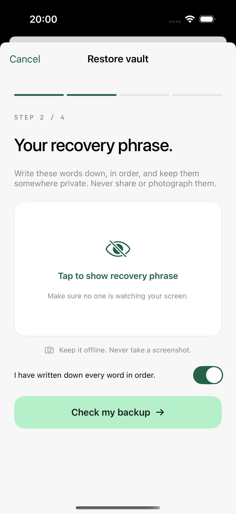

# Background navigation retention

The final direct-signing regression passed on 2026-09-21: 57 native tests and three targeted UI flows on iPhone 16 Pro / iOS 18.6 simulator. The final run did not repeat the full creation/restore UI suite. Its earlier 2026-09-20 pass is retained below as historical evidence with its original scope.

## Behavior

- Backgrounding, inactivity, and capture-related suspension revoke authorization without dismissing the current page or sheet.
- Setup keeps its current step, name, mnemonic, BIP39 passphrase, and any creation-backup acknowledgement in memory. Creation's full-phrase backup is concealed again; wallet passwords and verification selections are cleared. Restore text remains directly visible after return, and creation verification redisplays the same questions and option order without selected answers. Unfinished drafts are not persisted across process termination.
- Settings backup management stays on the same route but releases its decrypted secret and requires password authentication again. Unlock sheets remain open with empty passwords.
- Signing preserves the unsigned review or completed public response and displays it after return without requiring an account-viewing unlock. The signature password and risk acknowledgement are cleared; an in-flight signature cannot publish after suspension. Starting another signature requires the selected wallet's password again. Pairing still requires account unlock, preserves the selected chain/profile/script, and regenerates its public QR after unlocking.
- Choosing a signing wallet within an unsigned review preserves that request and revokes old authorization. Explicit manual lock and general wallet navigation still reset the relevant workflow. Successfully committed vault creation is not reported as a failed creation when automatic unlock is interrupted.
- Account viewing, pairing, and history retain single-wallet unlock semantics. The inactivity timer checks every 15 seconds for more than 120 seconds since the last recorded activity; it is not a fixed two-minute interval from unlock. Locked history remains hidden even when a new one-operation signature appends a receipt.
- When manual lock leaves the signing view mounted, that view restarts sensitive-session tracking. Fresh password input on the still-mounted page therefore remains subject to inactivity clearing.

## Current direct-signing regression — passed

The final run passed 57 native tests (54 Swift Testing + 3 hosted XCTest) and three UI flows: `testLockedSigningCanScanAndReviewWithoutUnlock`, `testVaultNavigationAndRecoveryValidation`, and `testSettingsSheetsSurviveBackgroundAndUnlockPasswordClears`. Result: `Test-BitSigner-2026.09.21_10-02-50-+1000.xcresult`, `TEST SUCCEEDED`; the [exported summary](Direct-Signing-Results.json) records 60 unique tests and 67 device executions including parameterized instances, with no failures or skips.

The direct-signing UI test opens scanning while locked, pastes a public request for review, selects the risk acknowledgement and enters a public test password, then backgrounds and reactivates the app. It verifies the same review remains, the password is empty, risk acceptance is cleared, and no account-unlock gate appears. The other two UI flows cover main navigation/invalid restore input and Settings compatibility/unlock-sheet retention. This final run does not establish a new pass for the remaining creation/restore UI tests.

Native session tests passed for locked import/review/signing, unsigned-review retention when choosing a signer, cancellation on wallet change/background, and history append without exposure or overwrite; scanner-frame tests passed for unreadable/empty/oversize input and throttling. All 52 engine tests also passed. See [Direct-Signing.md](Direct-Signing.md) for the final bundle identity and remaining physical-camera/imToken round-trip acceptance.

## Historical simplified create/restore regression — passed

The unified run passed 44 native tests (41 Swift Testing + 3 hosted XCTest) and 8 UI tests: `Test-BitSigner-2026.09.20_20-57-32-+1000.xcresult`, `TEST SUCCEEDED`. See the [exported result summary](Restore-Flow-Results.json).

That UI run verified name/public-phrase retention in the visible restore editor; restoration advancing directly to its second step; password clearing and phrase-edit return; creation Step 2 retaining its original phrase while requiring new reveal consent; creation Step 3 preserving question positions and option order while clearing selections; creation Step 4 retaining its page with empty password fields; and Settings compatibility/unlock-sheet retention. The then-current native session-race and injected screenshot/lifecycle suites also passed. Exact eight-flow coverage is listed in [Recovery-Privacy.md](Recovery-Privacy.md); it does not establish the newer direct-signing behavior.

Physical-device screen locking, recording, scanner/share-provider transitions, optional BIP39 passphrase retention in the new UI, and broader device/display coverage remain to be validated. No test saves a real wallet or captures generated recovery material.

## Historical validation

The earlier lifecycle-retention build passed all 32 native tests (30 Swift Testing cases plus 2 hosted screenshot-alert XCTest cases), including 9 session tests covering request replacement, lock/resume, stale signatures after reauthentication, wallet switching, and interrupted creation. Its UI still used the older masked restore and concealed verification flow; these counts do not establish that the current changes pass.

Seven UI flows passed in that historical implementation: generated phrases start concealed; recovery validation/navigation; Step 1 draft retention; Step 2 retention, fresh reveal consent and unchanged public test phrase; Step 3 retention and successful backup verification; Step 4 retention with empty password fields; and Settings compatibility/unlock sheet retention. The first run used an earlier Settings object and failed its unlock-sheet retention assertion; the final rebuild reran both the complete Step 2 flow and Settings flow successfully.

Historical test result: `Test-BitSigner-2026.09.20_19-58-03-+1000.xcresult`, `TEST SUCCEEDED`. No publishing-during-update or unbalanced-presentation warnings were found in that run. Its post-background full-phrase backup screenshot was inspected: the route and acknowledgement remained, while recovery words were absent.



The UI test phrase is the public BIP39 vector; no user recovery material is used. Physical-device background/lock-screen and camera/share-provider transitions still require device validation.

```sh
DEVELOPER_DIR=/Applications/Xcode.app/Contents/Developer xcodebuild \
  -project BitToolSigner.xcodeproj -scheme BitSigner \
  -destination 'platform=iOS Simulator,name=iPhone 16 Pro,OS=18.6' \
  -parallel-testing-enabled NO CODE_SIGNING_ALLOWED=NO \
  -only-testing:BitToolSignerTests \
  -only-testing:BitToolSignerUITests/BitToolSignerUITests test
```
