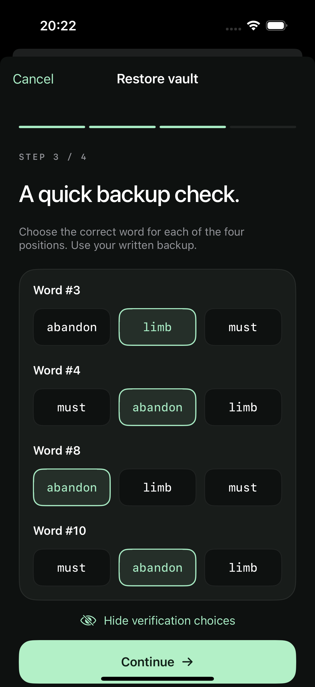

# Four-question backup verification

Directly visible creation verification passed simulator regression on 2026-09-20 using iPhone 16 Pro, iOS 18.6.

## Behavior

Creation Step 3 samples four different mnemonic positions and directly shows three word choices for each. It has no hide/reveal control or consent prompt. Positions are presented in ascending order; candidates are independently shuffled. All four questions must be answered before Continue is enabled, and all four answers must match to advance. Incorrect answers keep the same questions and selections so the user can correct them. Restore skips this screen entirely and goes from phrase validation to wallet-password setup.

Each entry from creation Step 2 generates a fresh challenge. Ordinary taps, redraws, screenshots, and background return do not change its positions or option order. Screenshots and suspension clear selections. Returning to review the full phrase discards the challenge; re-entering verification generates another one.

The candidate dictionary is read from the existing, locally bundled BIP39 English wordlist. Each question contains one correct word and two different decoys that exclude every word in the recovery phrase. Repeated correct words reuse the complete three-word candidate set with an independent shuffle, so a uniquely recurring word does not disclose the answer. Correctness is checked only by the model, never embedded in accessibility identifiers or option labels.

Options remain visible during ordinary use and are available to accessibility. The native privacy cover protects inactive/background and capture-related presentation; on return, the same choices display with no selections. Screenshot notifications present a warning and clear selections, but cannot erase the screenshot or the partial recovery information already captured. Normal text sizes use three columns; larger Dynamic Type sizes use full-width choices so long words remain readable. Colors follow the system appearance.

## Current simulator regression — passed

The unified run passed 44 native tests (41 Swift Testing + 3 hosted XCTest) and 8 UI tests: `Test-BitSigner-2026.09.20_20-57-32-+1000.xcresult`, `TEST SUCCEEDED`. See the [exported result summary](Restore-Flow-Results.json) and [precise overall scope](Recovery-Privacy.md).

Creation UI tests confirmed directly visible questions with no reveal control, one choice per position, Continue disabled until all four are answered, wrong-answer rejection with selections retained, correction and advancement, and unchanged positions/options with cleared selections after backgrounding. The full-phrase revisit test confirmed that creation Step 2 still requires reveal consent. Restore advanced directly to password setup without these questions. Model tests again covered all supported phrase lengths, distinct positions/options, phrase-excluded decoys, repeated-word candidate reuse, selection validation/reset, and deterministic randomization.

Five screenshot-session tests covered injected notifications and callback/lifecycle behavior; the actual screen capture and selection-clearing interaction on a physical device remain to be verified. Extreme Dynamic Type, narrow-screen layouts and VoiceOver were not newly validated by this run.

## Historical regression coverage

Before removing verification reveal consent and shortening restore, simulator validation passed on iPhone 16 Pro, iOS 18.6: 15 native tests (6 challenge tests, including 5 supported-length cases, and 9 privacy tests) plus 4 UI flows. The selected-choice screen was inspected in dark appearance; all four rows and full word labels were readable. The simulator's previous light appearance was restored after testing. Historical result: `Test-BitSigner-2026.09.20_20-19-58-+1000.xcresult`, `TEST SUCCEEDED`. This is not a result for the current flow.

`BackupVerificationTests` covers all five supported BIP39 lengths, four unique positions, three unique candidates, phrase-word exclusion, repeated words, partial/wrong/correct answers, selection reset, invalid inputs, and seeded randomization. Its wordlist and phrase generation use the actual bundled JavaScriptCore engine. The model also passed 80 deterministic standalone Swift checks.

Those previous UI flows used the public BIP39 test vector, never a user's phrase, and covered concealed entry, selection, wrong-answer rejection and correction, explicit hiding, background return, and continuing to password setup. Current creation tests use temporary generated drafts only in memory, without phrase/choice screenshot attachments; explicit hiding and concealed verification entry are no longer product requirements.

Historical preview, before removal of the hide control:



```sh
DEVELOPER_DIR=/Applications/Xcode.app/Contents/Developer xcodebuild \
  -project BitToolSigner.xcodeproj -scheme BitSigner \
  -destination 'platform=iOS Simulator,name=iPhone 16 Pro,OS=18.6' \
  -parallel-testing-enabled NO CODE_SIGNING_ALLOWED=NO \
  -only-testing:BitToolSignerTests \
  -only-testing:BitToolSignerUITests/BitToolSignerUITests test
```
